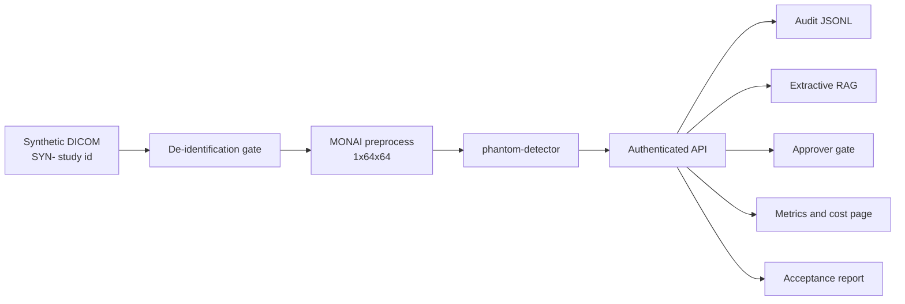

# Architecture

The platform is one vertical slice over synthetic data, plus the controls around it. Each box below has code, a manifest, or a test in this repository. Boxes that need a GPU stay specified and unmeasured.

## Imaging path

`hafactory.dicom_synth` writes a secondary-capture DICOM. The pixels are a 64×64 geometric sphere from `hafactory.phantom`. `PatientName` is `SYNTHETIC`. `PatientID` and `StudyID` start with `SYN-`. Accession number, birth date, sex, address, institution, referring physician, and medical-record fields are omitted.

`hafactory.deid` reads those fields back and raises `DeidError` when any forbidden field is non-empty, when an identifier leaves the synthetic vocabulary, or when pixel data is missing. The API turns that error into HTTP 422 and deletes the uploaded temp file.

`hafactory.preprocess` runs MONAI `EnsureChannelFirst`, `ScaleIntensity` to 0..1, and `Resize` to 64×64. A missing MONAI install raises `RuntimeError`. There is no second transform stack.

`hafactory.detector` scores the fraction of pixels above 0.5. The label is `phantom-present` at 0.05 or above. The runtime string on this path is `local-cpu`. The model role string is `synthetic geometric detector, not a diagnostic device`.

## Serving path

`models/phantom-detector/` is a Triton Python-backend repository. `config.pbtxt` requests one GPU instance and a max batch of 8. `1/model.py` repeats the bright-pixel score so the Triton image does not import the application package. The unit test loads that file and compares the score with `hafactory.detector.probability`.

The API calls the local detector when `HAF_TRITON_URL` is empty. When the URL is set, the API returns HTTP 503 and records the denial. This process does not contain a measured Triton client result, so it does not pretend one. `force_triton_down=True` is the fault-injection switch and also returns 503.

TensorRT and ONNX Runtime are the parity options named by the `tensorrt-or-onnx-parity` gate. They are not wired, and there is no parity number. NVIDIA NIM is `enabled: false` in the Helm values. Hosted generation endpoints, including hosted NIM, are out of policy for this clinical path. The assistant never calls a network model.

## Private assistant

`data/synthetic_notes.json` holds three notes, `SYN-NOTE-001` through `SYN-NOTE-003`. `patient_records` is 0 and `evidence_class` is `EXAMPLE`. Retrieval is token overlap. The answer is sentences copied from the retrieved notes. `assert_grounded` rejects any sentence that is not a substring of a cited note. No overlap returns `refused`. Questions that ask to prescribe, diagnose, or write to an EHR return `approval-required` and an empty answer.

Export is a different route, `POST /v1/actions/export`. A reader cannot grant approval. An approval is bound to one tenant and one `SYN-` study id. Another tenant holding the same approval id receives HTTP 403. The success body names `site-record-system-placeholder`. No external system is called.

## Tenancy and cluster shape

Two layers exist.

The API takes tenant and role from the bearer token map. The request body cannot select a tenant. Dev fixtures `dev-reader-a`, `dev-approver-a`, and `dev-reader-b` exist so the tests can show isolation. A deployment replaces that map with the site identity provider. The strings are fixtures, not production secrets.

The namespace `clinical-inference` sets Pod Security `restricted`. The API service account automounts no token and can `get` configmaps only. The resource quota includes `requests.nvidia.com/gpu: "1"`. The default network policy denies ingress and egress. One policy allows TCP 8080 to pods labeled `app=inference-api`. The API container uses a read-only root filesystem, uid 65534, dropped capabilities, and an `emptyDir` at `/tmp`. It requests no GPU. `HAF_TRITON_URL` is empty in the manifest.

The Triton Deployment is pinned at `replicas: 0`, so applying the manifest does not request a GPU. Its model volume is an `emptyDir` until an acceptance window mounts the model repository read-only. The Helm chart repeats that shape and leaves `triton.enabled` and `nim.enabled` false. Helm templates contain `{{ }}` and are rendered by Helm. The manifest test parses `deploy/kubernetes/*.yaml`, `deploy/prometheus/rules.yaml`, and `values.yaml`.

## Observability and release

`GET /metrics` exposes two process counters, `hafactory_inference_requests_total` and `hafactory_inference_latency_seconds_sum`. The text says they are local API counters. `deploy/prometheus/rules.yaml` pages on `InferenceApiDown` after five minutes and opens a ticket when the API is up and idle for thirty minutes during a staffed window. No sample series is shipped with the rule.

`hafactory.economics` publishes one assumption: $3.50 per GPU-hour, dated 2026-10-19, divided by 18,000 assumed inferences per GPU-hour. Utilization is `None`. The HTML page is generated by `render_dashboard` and committed at `observability/gpu-economics.html`.

`hafactory.loadtest` times the in-process detector and labels the record `EXAMPLE` / `local-cpu`. `python -m hafactory.loadtest` prints that JSON. It is the load-test harness for this slice. It does not start Triton.

`hafactory.acceptance_report` runs the software slice and reads `benchmarks/gpu-evidence.json` when that file exists. The committed report is `acceptance/deployment-acceptance.md`. With no evidence file the decision is **NO-GO**.

## Tracking

MLflow is the tracking server a later training loop would use. This repository does not start MLflow and does not contain experiment runs. The release record for the slice is the acceptance report, and the repeatable check is pytest.

## Companion repository

Physical GPU factory design, NVLink, InfiniBand, NCCL, and Slurm acceptance live in [h100-ai-factory-reference-architecture](https://github.com/JatinF/h100-ai-factory-reference-architecture). This repository is the healthcare workload and the service-delivery controls that would run after that factory has measured evidence. The $3.50 per GPU-hour figure is the same planning assumption, dated 2026-10-19, in both places. Neither repository records a GPU measurement.
